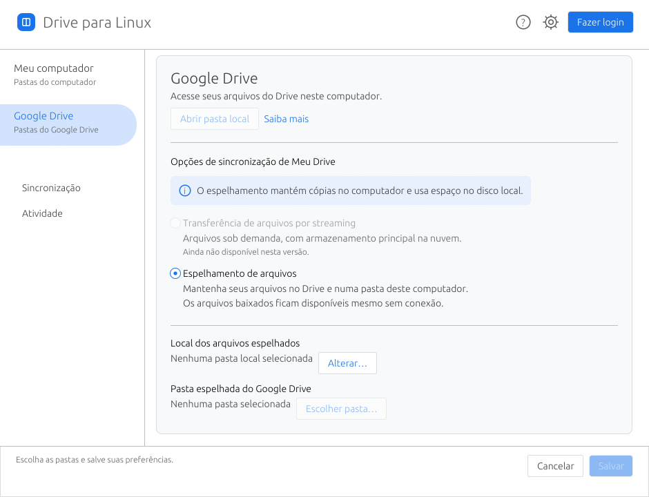

# Drive para Linux

[Licença GPL-3.0-only](LICENSE) · [Distribuição e pacotes](docs/distribution.md)

[Página do aplicativo](https://goncalvesl.github.io/gdrive-clone/) · [Política de Privacidade](https://goncalvesl.github.io/gdrive-clone/privacy/) · [Termos de Serviço](https://goncalvesl.github.io/gdrive-clone/terms/)

**[Baixar a prévia v0.1.2](https://github.com/goncalvesl/gdrive-clone/releases/tag/v0.1.2)** — AppImage, deb, rpm e Arch Linux (x86_64). O cliente OAuth de distribuição ainda não acompanha os pacotes; sem ele, o login não está disponível.

Cliente independente do Google Drive em Rust, com motor próprio, SQLite e interface desktop nativa egui. Sem rclone, Electron, Tauri ou interface JavaScript.

**Estado: prévia executável de espelhamento, para homologação.** Há OAuth, adaptador da API Drive v3, operações em arquivos reais, journal recuperável, CLI, interface e instalador de usuário. O usuário confirmou login e leitura de pastas numa conta real; transferências e recuperação ainda não foram homologadas. Não é uma versão final nem um produto oficial do Google.

## Executar

```sh
cargo run -p drive-desktop
```

Para gerar e instalar o binário otimizado no seu usuário:

```sh
./scripts/install.sh
```

O instalador prepara o serviço, mas não o ativa. A interface abre as preferências de **Google Drive**, com navegação **Meu computador / Google Drive**, tema claro e ações **Salvar / Cancelar**. Use **Fazer login** no cabeçalho e escolha as pastas remota e local. A distribuição deve fornecer o cliente OAuth do projeto; esta árvore não contém credenciais reais. Configuração manual está restrita à seção de desenvolvimento. Execute uma prévia antes de sincronizar. Veja o [guia de uso](docs/user-guide.md).

## O que funciona no escopo implementado

- Espelhamento bidirecional de arquivos e pastas, inclusive vazias; renomeação/movimento com IDs estáveis.
- Referências .gdoc/.gsheet/.gslides para abrir documentos Google no navegador.
- Criação, edição, renomeação e movimentos dentro da raiz, com IDs remotos estáveis.
- Conflitos preservados e ação explícita para manter ambas as versões.
- Exclusões opcionais: lixeira no Drive e cópias recuperáveis locais.
- SQLite transacional, inspeção de efeitos interrompidos e replanejamento explícito.
- Prévia sem efeitos sobre conteúdo, pausa, histórico, CLI JSON e modo periódico.
- OAuth com PKCE, callback loopback e refresh token no Secret Service Linux.

A evidência inclui 125 testes locais (um deles é helper de subprocesso), servidores HTTP simulados e inspeção da interface. Isso não comprova equivalência com o aplicativo oficial ou funcionamento de todos os endpoints em produção.

## Limites atuais

Sem streaming/FUSE, múltiplas contas simultâneas, shared drives, edição offline de documentos Google ou exclusão de árvores de pastas. Nomes remotos duplicados recebem aliases locais estáveis derivados do ID; árvores com esses aliases usam inventário completo após eventos Changes para recalcular a projeção. Itens/tipos ainda incompatíveis bloqueiam o inventário em vez de serem ignorados silenciosamente. Uma pasta remota dedicada é o escopo de homologação desta prévia.

Uploads em blocos retomam após consultar a sessão/offset persistidos; downloads binários retomam pelo tamanho do staging e validam `Content-Range` e checksum antes da instalação. O serviço usa watcher local; o cursor Changes atualiza arquivos por ID e reusa o inventário sem eventos; renomeações/movimentos de pastas conhecidas atualizam subárvores por ID; criação/remoção de pastas e colisões provocam varredura completa. Cópias locais de recuperação não são removidas automaticamente. A GUI mostra progresso por bytes e consulta dados/armazenamento da conta. Falhas transitórias permitem novas tentativas com espera; pausa compartilhada entra em vigor entre operações.

## Engenharia e continuidade por IA

Comece por [AGENTS.md](AGENTS.md). Consulte [roteiro](ROADMAP.md), [arquitetura](docs/architecture.md), [paridade](docs/target-app-parity.md), [testes](docs/testing.md) e [registro de trabalho](log/devlog.md). Fontes e limites da inspiração PhotoCraft estão em [referências](docs/reference/sources.md).

```sh
./scripts/check.sh
```


